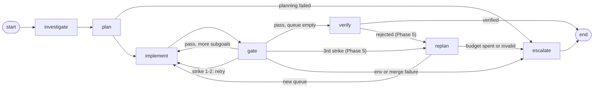

# Jev State Engine 2.0 — Plan

**Baseline:** `master` @ `d09d618` (after `--test-policy`).
**Method:** read `engine.py`, `workspace.py`, `gatekeeper.py`, `models.py`, `main.py` and `docs/`; ran the test suite on Linux (260 passed, 3 failed; the three `test_live_substep_*` files excluded; failures explained in §3).
**Evidence tags:** **ran** = executed and observed · **read** = from reading code only.
**Enforcement tags:** **[M]** mechanically enforced · **[P]** prompt-only · **[P+M]** prompt with a mechanical backstop.

---

## 1. Thesis

The core is sound: a deterministic FSM, one git worktree per subgoal, an integration branch that `main` only fast-forwards to after final verification, and a two-tier gate (mechanical, then Jev). 2.0 does not need a bigger machine. It needs the engine to **remember its own attempts**.

Today a failed attempt is destroyed on rollback (only `diff_size` is logged), the semantic gate returns no reason, and every ticket starts from zero. Everything valuable in the old plan (dead-end injection, calibration, cross-ticket memory, smarter re-planning, the eval) needs that record first.

Order of work: **close the holes → record everything → use the record to make retries smarter → add cross-ticket memory → only then change control flow (re-planning) and thresholds (calibration)**, because those two cannot be set honestly without data.

---

## 2. Where the engine stands

- **FSM:** `investigate → plan → implement → gate → (implement | verify | escalate)`, then `verify → END | escalate`. *read*
- **Isolation:** each subgoal runs in its own worktree branched from `jev-ticket-<thread_id>`, merged by fast-forward on pass, discarded on fail. `main` moves only in `fast_forward_main` after verify, and that refuses on a dirty tree or a diverged `main`. *read*
- **Tier 0:** build → compile (table-driven: JS/TS, Go, Rust, Maven, Gradle, Java/Kotlin, Python; baseline-worktree comparison) → tests (per `--test-policy`) → scope. Fails closed on `ENV_NOT_READY` and `NO_COMPILE_COMMAND`. *read*
- **Tier 1:** one Noul question to Jev. The probability is already parsed and stored in `trajectory[].jev_verdict.probability`. *read*
- **Proven live (your runs):** About page, multi-file Contact page, forced-failure escalation with `main` untouched.
- **Not proven live yet:** main diverged, dirty tree, interrupt/resume (Appendix A).

---

## 3. What the code told us

| # | Finding | Evidence | Impact → addressed in |
|---|---|---|---|
| F1 | **A worker write can escape its worktree.** The scope guard in `node_implement` normalizes with `lstrip("./")`, which strips *characters*: `../../x` becomes `x` and passes a scope of `x` (`.env` also becomes `env`). `Workspace.stage_file_mutation` then joins the raw path onto the worktree with no containment check. I confirmed the second half: `stage_file_mutation("../escape.txt", …)` created `.jev-worktrees/escape.txt`, and it was **absent from the staged diff**, so Tier 0's scope check cannot see it. | **ran** (workspace half) + **read** (guard half); not run through the LLM tool wrapper | High. Breaks the isolation invariant; matters before open-sourcing → Phase 0 |
| F2 | `Workspace.run_read_tool` blocks `..` traversal only inside the Windows fallback (when `cat` is missing). On Linux/Mac a real `cat ../outside.txt` runs, and your own test fails there. The LLM-facing `read_file` has its own guard, so the exposure is one layer down. | **ran** | Medium. Blocks Mac testing → Phase 0 |
| F3 | Jev's `reason` is always `None` **by design** (a Noul answer has no text; `docs/TASK.md` says so). On a semantic rejection the worker gets a canned paragraph plus the probability, so semantic retries are nearly blind. | **read** | High leverage → Phase 3 |
| F4 | Failed attempts leave no record: the worktree is discarded and the trajectory keeps `diff_size`, not the diff. No dead-ends, no calibration set, no fix examples. | **read** | High leverage → Phase 1 |
| F5 | `execute()` always starts from a fresh state and runs `branch -D` on the integration branch before recreating it, so partial progress from an earlier run on that thread id is deleted; the checkpointer is not providing resume. (How LangGraph treats an interrupted thread was not tested.) The default `--thread-id` is the constant `main-thread`. | **read** | Medium → Phase 0 |
| F6 | `escalate_deadlock` writes `escalation.log` to the current directory, overwritten on every escalation, not keyed by run. | **read** | Low–medium → Phase 0 |
| F7 | A final-verify rejection escalates the whole ticket even though every subgoal passed. There is no repair attempt. | **read** | Design gap → Phase 5 |
| F8 | The worker has **no shell** (tools: `list_dir`, `grep`, `read_file`, `stage_file_mutation`, `submit_subgoal`). The old Pillar 3 problem "runs npm in a bun repo" cannot happen; the engine runs the commands. What a profile fixes is convention drift (ESM vs CJS, wrong runner assumptions in plans) and prompt bloat. | **read** | Shapes Phase 2 |
| F9 | The old Pillar 2 hazard (a file-level rollback wiping an earlier subgoal) does not exist: failure discards a whole worktree and the integration branch only fast-forwards. What is missing is recording the SHAs. | **read** | Shrinks Phase 1 |
| F10 | When no tests run (no script, `verify-only`, `never`), the gate is compile + Jev only. Any "mechanical evidence overrides doubt" rule must check that tests actually ran. | **read** | Design constraint → Phases 2, 6 |
| F11 | `test_compile_failure_after_subgoal_that_ran_tests_telemetry_not_leaked` fails on Linux (`mechanical_failure` instead of `passed`). Cause undiagnosed; may be environmental. `test_live_jev_api_call` also fails without `JEV_API_KEY`, as expected for a live test. | **ran** | Triage → Phase 0 |

---

## 4. Invariants (never traded away)

1. **Inversion of control.** The engine receives workspace, gatekeeper, llm, recorder, profiler and memory through its constructor. Nothing global.
2. **Isolation.** Worker writes are confined to a subgoal worktree (now enforced by path containment, not assumed). `main` moves only by the final fast-forward after verify.
3. **Mechanical evidence outranks semantic opinion when it exists**, and every result states which evidence existed (evidence level, Phase 2).
4. **Every state-changing git action is recorded with SHAs** in the ledger.
5. **Memory is derived, provenance-tagged and disposable.** It never overrides a mechanical check.
6. **New behavior ships off, or in shadow mode, until the ledger shows it helps.**
7. **Every fix declares its enforcement** ([M], [P] or [P+M]). Where a prompt-only fix has already failed once, it gets a mechanical backstop.

---

## 5. What happened to the old eight pillars

| Old pillar | Verdict | Why |
|---|---|---|
| 1. Dynamic re-planning | **Keep, reshaped → Phase 5** | Engine-initiated first; re-planning replaces an escalation, never a live attempt. Worker-initiated tool deferred. |
| 2. Git-commit lineage & delta rollbacks | **Mostly already built → Phase 1** | Worktree-per-subgoal + fast-forward already gives clean rollback (F9). Only SHA recording remains. |
| 3. Structured repo profile | **Keep → Phase 2** | Reuse the existing handlers; value is convention facts and evidence level, not preventing shell misuse (F8). |
| 4. Domain-grouped state | **Defer** | No behavior change; touches every node and most of the 260 tests. Add one typed sub-dict per new feature instead. |
| 5. Tri-level graph memory | **Split** | Level 3 (episodic) → Phase 4. Level 2 (execution DAG) dropped: git + ledger already are that graph. Level 1 (code graph) deferred with a trigger. |
| 6. Run & failure ledger | **Keep → Phases 1 and 3** | The foundation. DPO export deferred until something can consume it. |
| 7. Uncertainty band | **Keep, data-gated → Phase 6** | Shadow mode first; edges from data, not the assumed 0.30/0.70; mechanical override only when tests ran. |
| 8. Process-reward interceptors | **Mostly exists; fix the hole** | Scope confinement exists (and is broken, F1 → Phase 0). Dependency hygiene becomes evidence (Phase 2). Interface check deferred. |

---

## 6. Architecture 2.0



Today the 3rd strike and a verify rejection go straight to `escalate`; `replan` arrives in Phase 5. Three side channels attach to the existing nodes and add no new states:

- **Recorder** (Phase 1): every node writes facts to `ledger.db`.
- **Profile** (Phase 2): plan and implement prompts get hard repo facts; the gate gets the evidence level.
- **Memory** (Phase 4): plan and implement prompts get a few verified hints.

```python
engine = JevEngine(
    workspace=workspace, gatekeeper=gatekeeper, llm=llm,
    recorder=SqliteLedger(...),    # Phase 1  (default: NullRecorder)
    profiler=RepoProfiler(...),    # Phase 2  (default: none)
    memory=KnowledgeStore(...),    # Phase 4  (default: NullMemory)
)
```

---

## 7. Roadmap

| Phase | Name | Size | Needs | Changes current behavior? |
|---|---|---|---|---|
| 0 | Close the holes | S | — | Yes (bug fixes) |
| 1 | Ledger & lineage | M | 0 | No |
| 2 | Repo profile & evidence level | M | 0 | Prompts only |
| 3 | Retry intelligence | M | 1 | Retries only |
| 4 | Episodic memory | L | 1, 2 | Off by default |
| 5 | Re-planning | L | 1, 3 | Only where it used to escalate |
| 6 | Calibrated gate | M | 1 (data) | Shadow first |

Phases 2 and 3 are independent and can be built in either order after Phase 1. Phase 6's offline analysis can start as soon as Phase 1 has produced runs.

### Working agreement (every phase)

One branch per phase (`phase-<n>-<name>`). Antigravity implements in the **D: repo**; live runs happen from the **Desktop clone** against jp-bat reset to `baseline-clean`. `git fetch` before `git pull`. The agent lists every unrequested change separately. Claims are checked against real test output, not the agent's summary. Hardening tests are written first and shown failing on the old code.

---

### Phase 0 — Close the holes (S)

*Why first:* F1 breaks the isolation invariant; F2 and F11 block Mac testing; F5 and F6 make runs collide.

- **0.1 Path containment [M].** Add `Workspace.resolve_in_worktree(path)`: normalize with `posixpath.normpath`; reject absolute paths, `..` segments, drive letters, and anything whose resolved path (symlinks followed) leaves the worktree. Use it in `stage_file_mutation`, `run_read_tool` and the `node_implement` tool guard. Delete `lstrip("./")`; strip only a leading `./`.
- **0.2 Platform parity.** Apply the read guard on every platform. Get the suite green on Linux and Mac. Diagnose F11. Put `test_live_jev_api_call` behind a `live` marker that skips without `JEV_API_KEY`.
- **0.3 Per-run artifacts.** Introduce `JEV_HOME` (default `~/.jev`). Escalation output goes to `$JEV_HOME/runs/<thread_id>/escalation.json`. The default thread id becomes `run-<utc-timestamp>-<4 hex>` unless `--thread-id` is passed.
- **0.4 Resume semantics.** Make today's behavior explicit: if the thread already has a checkpoint, print that this run restarts and deletes `jev-ticket-<id>`. A real `--resume` is out of scope (§11, decision 1).
- **Tests:** `../x`, `../../x`, `.env` ≠ `env`, `.github/…`, absolute path, symlink pointing out, backslash form.
- **Exit:** suite green on Windows and Mac; Appendix A scenarios 1–3 run live.

### Phase 1 — Ledger & lineage (M)

*Why now:* it is the prerequisite for Phases 3–6 and for the eval, and it changes no behavior.

- `Subgoal.id` (stable, e.g. `sg-1`) and `Subgoal.status` ∈ `pending | in_progress | committed | failed | pruned`, both defaulted so the existing tests keep passing.
- `src/jev/ledger.py`: a `Recorder` protocol, `NullRecorder` (default), `SqliteLedger` (schema in Appendix B), injected into `JevEngine`.
- **Capture points:** run start/end; the plan; every gate outcome (**read the diff before the worktree is discarded**); Jev's raw response (with the model version it reports and its token usage); verify. Lineage: `parent_sha` and `commit_sha` per committed subgoal (`get_branch_commit` before and after merge). Also token usage when the LLM response carries it, and the length of `investigation_notes` so Phase 2 can size a cap from data.
- **Refactor note:** `node_gate` repeats its worktree teardown in four branches. Extract one `_snapshot_attempt()` and one `_teardown_worktree()` so the recorder is called once per outcome.
- `scripts/ledger_report.py` (read-only): prints a run's subgoals, attempts, outcomes, probabilities and SHAs.
- **Tests:** exactly one attempt row per gate outcome; rows survive rollback; `NullRecorder` leaves behavior identical; recorded SHAs equal `git rev-parse`.
- **Exit:** the About and forced-failure tickets on jp-bat each produce a complete ledger report.

### Phase 2 — Repo profile & evidence level (M)

- **`RepositoryProfile`** (Pydantic, small by design; aim for ~150 tokens, to be measured): per ecosystem, the root, manifest, package manager (from the lockfile), module system (`"type"` in `package.json`, `tsconfig` `module`), compile command, test command or `none`, and major frameworks from dependencies. Built from manifests with zero LLM tokens, **reusing the existing compile and test handlers' detection** (no second detector), cached by manifest hashes. Table-driven so Python, Go, Rust and JVM repos get the same treatment as JS/TS.
- Injected into plan and implement prompts **[P]**. The mechanical backstops already exist: the compile gate and `ENV_NOT_READY`.
- Investigation stays for soft conventions (product identity, naming, styling). Profile = hard facts; notes = judgment. Cap the notes using the lengths Phase 1 recorded.
- **Evidence level [M]** on every result and ledger row: `tests+compile` · `compile-only` · `semantic-only`, derived from what Tier 0 actually ran. Closes F10 and makes "no tests ran" visible instead of implied.
- **Dependency delta [M]:** parse manifest diffs into `{added, removed}`, pass it to Jev as structured evidence in `state`, and print it in the final summary. It is evidence, not a blocker (Tier 0 scope already rejects manifests that are not in scope).
- **Tests:** fixtures per ecosystem (JS with bun/pnpm/npm, Python, Rust, Go, Maven); profile output is deterministic; evidence level matches each `--test-policy`.
- **Exit:** jp-bat profile is correct; the evidence label is correct under `--test-policy never`.

### Phase 3 — Retry intelligence (M)

*Why:* F3 + F4. The highest quality gain per line of code.

- **Dead-end block [P+M].** On a retry, the implement prompt gets up to 2 prior failed attempts of the same subgoal, rendered from the ledger by template (files touched, failure kind, normalized compile/test error keys, a short diff excerpt) with "do not repeat". **Backstop [M]:** if the new diff's SHA equals an earlier failed attempt of the same subgoal, fail it immediately without running tests or calling Jev, counted as a strike of the original tier.
- **Typed semantic rejection [P+M].** Verified live (`jev-1.13.0`): one request carries several named questions and Jev returns typed answers only, with no explanation text. Send the extra questions in the **same request every time** (questions cannot see each other's answers) and use them only when `valid` is false: yes/no checks (e.g. `exceeds_scope`, `incomplete`, `contradicts_notes`) plus a `choice` over failure kinds, which returns the chosen option, a `confidence` and per-option `probabilities`. Feed the strongest findings plus deterministic facts (files touched vs scope, lines changed, evidence level) back to the worker instead of the canned paragraph. Still one Jev call per gate. Mechanical part: getting the findings. Prompt-only part: the worker acting on them, backed by the duplicate-diff guard and the strike counter.
- **Tests:** dead-end block contents; the duplicate-diff short-circuit calls neither tests nor Jev; fallback path when the API rejects the second question.
- **Exit:** on the forced-failure ticket and one hard ticket, retries differ from the failed diffs and the typed reason appears in the feedback.

### Phase 4 — Episodic memory (L)

Design in §8.

- `src/jev/memory.py` (`KnowledgeStore`, `NullMemory`); an extractor that derives facts from the ledger; retrieval and injection into plan/implement prompts; `--memory off|read|readwrite`; `scripts/memory.py list | forget | rebuild`.
- Default `off`. Flip to `readwrite` only after the A/B in §9 shows no regression.
- **Tests:** extraction from ledger fixtures; invalidation when an evidence hash changes; budget cap; with memory `off`, prompts are byte-identical to today's.
- **Exit:** an A/B run (memory on vs off) on a fixed ticket set, recorded in the ledger.

### Phase 5 — Re-planning (L)

*Key design choice:* re-planning **replaces an escalation, never an attempt that might have succeeded.** Triggers: **T1** a subgoal about to take its 3rd strike; **T2** a final-verify rejection (F7). So the worst case equals today's behavior.

- New `replan` node. It calls the existing planning path with extra context (committed subgoals, failed attempts from the ledger, the verify feedback), so the **existing schema validation and grounding checks apply unchanged**. Its output replaces only the *remaining* queue; committed subgoals are never rewritten; dropped ones are marked `pruned`.
- **Mechanical caps [M]:** `replan_budget` default 1 (max 2) as a hard counter in state; at most 4 new subgoals; budget exhausted or an invalid plan → escalate.
- **Before building,** query the ledger: of subgoals that took a 2nd strike, how many passed on the 3rd attempt? If most do, T1 stays at the 3rd strike; if almost none do, consider moving it to the 2nd.
- **Not in this phase:** the worker-initiated `request_plan_modification` tool. It lets the model widen its own scope; revisit after this proves safe.
- **Tests:** budget consumption; exhausted → escalate; invalid re-plan → escalate; committed lineage untouched; the T2 path.
- **Exit:** a recoverable forced failure completes via one re-plan live; an unrecoverable one escalates having used exactly one.

### Phase 6 — Calibrated gate (M, data-gated)

*Why last:* thresholds need data. Also, false passes are partly backstopped by `verify_ticket`, while false strikes cost retries. So the band's main job is to cut wasted retries on near-50% rejections, not to stop bad merges.

- **6.0 Offline analysis.** Label a set of ledger diffs ("would a human merge this?"; target ≥ 50) and tabulate Jev probability against the label. Mine proxies too: Jev-passed subgoals that later failed final verify, and Jev-rejected subgoals the worker later fixed without material change. A live call showed noul answers carry only a probability (no boolean `value`), so the `≥ 0.5` cut-off in `_parse_noul_verdict` is ours and the band edges are fully ours to set. `choice` answers also carry a `confidence`; test an accept/reject `choice` as an alternative gate. Calibration is tied to the model version (a `jev-latest` request came back as `jev-1.13.0`), so the ledger records the version and a version change means re-checking.
- **6.1 Shadow mode.** Compute, log and store what the band *would* have decided. No behavior change.
- **6.2 Enforce, behind flags (default off).** Band edges come from 6.0, not from assumed 0.30/0.70. (a) *Inverse consistency probe:* ask Jev "does this diff violate the requirements?" and treat two high answers as inconsistent. (b) *Mechanical primacy only when tests ran* (evidence level `tests+compile`), never on `compile-only`. (c) *Criticality* via configurable path globs (manifests, lockfiles, CI) with a stricter pass bar. (d) *True ambiguity* → the existing `escalate` node with `triggering_tier="uncertain"`.
- **Exit:** on the labeled set, shadow decisions beat plain `P ≥ 0.5` (fewer wasted retries, no more verify-caught false passes) before anything is enforced.

---

## 8. Memory design

| Layer | What it holds | Authority | Lifetime |
|---|---|---|---|
| **Ledger** (`ledger.db`) | Append-only facts of what happened | Source of truth | Permanent |
| **Profile** | Hard repo facts, cached by manifest hash | Re-derived every run, so not really "memory" | Recomputed |
| **Knowledge** (`knowledge.db`) | Derived hints | Advisory only | Disposable; rebuildable from the ledger |

**Five rules**

1. **Mechanical origin.** Facts come from ledger events (compile or test failure signatures, and what fixed them), rendered by template. No LLM-authored "lessons".
2. **Provenance.** Every fact points to a run, attempt and commit.
3. **Self-invalidating.** Each fact stores hashes of its evidence (`package.json`, the lockfile, the file concerned). They are rechecked on retrieval; a mismatch marks the fact `stale` and it is not injected. A TTL applies on top.
4. **Budgeted and labeled.** At most 5 facts / ~400 tokens, ranked deterministically (scope-file overlap, then recency, then proven usefulness), labeled "hints from earlier runs; verify against the code".
5. **Disposable and inspectable.** `memory list | forget | rebuild`; `--memory off | read | readwrite`.

**What is stored**

- **`compile_trap` / `test_trap`:** signature = `(code, file, normalized message)`, statement from a template, plus a **fix hint** when a later attempt of the same subgoal passed (the ≤ 40-line diff that did it). Only errors Tier 0 already classifies as *new* against the baseline worktree are recorded, so pre-existing breakage is never learned as a trap. These same pairs are the "chosen / rejected" data a future fine-tuning export would need, so one mechanism feeds memory, dead-end injection and that export.
- **`env`:** causes of `ENV_NOT_READY` (missing runner, missing install).
- Hand-written conventions: out of scope for now.

**Retrieval:** plain SQL on `(repo_key, scope file/dir overlap, error code)`. No embeddings: they add a nondeterministic dependency, and facts keyed by file and error code are small and exact.

**Repo identity:** `repo_key` = hash of the root commit(s), stable across clones, so the D: repo and the Desktop clone share one memory.

**Later (not now):** split investigation into a ticket-independent repo map, cacheable and validated by `git rev-parse HEAD:<dir>` tree hashes (an exact, mechanical test), plus a ticket-specific delta. Today's notes mix both, so caching them as-is across tickets would be unsafe.

---

## 9. Measuring success

The ledger gives per-run metrics with no extra instrumentation: subgoals, attempts per subgoal, strikes by tier, Jev calls, escalation rate and reason, evidence level, wall time, tokens.

- Use a **fixed ticket set on jp-bat** (define it together with the eval project).
- Each phase from 3 on ships with an off switch, so the same ticket can run both ways.
- **2.0 is better if** escalation rate and attempts per subgoal fall **without** more final-verify rejections.

---

## 10. Deferred, with triggers

| Item | Why not now | Revisit when |
|---|---|---|
| Code graph (old L1) | One parser per language; the worker already has `grep` and `read_file` | The ledger shows repeated "broke a caller" failures the compile gate missed (likely untyped JS) |
| Execution DAG (old L2) | Git + ledger `parent_sha` already are the DAG | — (dropped) |
| Domain-grouped `State` | No behavior change; touches every node and most tests | `State` passes ~30 keys, or serialization warnings become errors |
| Interface-preservation guard | Needs the code graph | Same as code graph |
| Worker-initiated plan modification | Lets the model widen its own scope | Engine-initiated re-planning has proven safe |
| DPO export script | Pairs are captured from Phase 1, but hosted Gemini cannot be fine-tuned, so nothing consumes them yet | There is an open-weight worker to train |
| OS-level sandbox, license, CI, MCP tool gating | Deferred by you; Phase 0.1 is the cheap partial | As planned |
| Mac/Linux testing | Moves **up** into Phase 0 | — |

---

## 11. Open decisions

1. **Resume or restart?** (F5) **Decided: restart** with a loud warning; add `--resume` only if runs get long enough to matter. Every attempt is kept in the ledger either way.
2. **`JEV_HOME` default:** **Decided: `~/.jev`** (clean target repos, keyed per repo).
3. **Can Jev return a reason, and can one request carry several questions?** **Confirmed by a live call:** no explanation text; several typed questions per request work, including `choice` (with `confidence` and per-option `probabilities`). It was one obvious test case, so it proves the mechanics, not answer quality (Phase 3 and 6 measure that).
4. **Who labels diffs for Phase 6?** **Open** (you, teammates). Not needed before Phase 6.
5. **Memory default:** **Decided: built in Phase 4, off by default.** Flip to on only after the A/B in §9.

---

## Appendix A — Live proof checklist

Run from the **Desktop clone**, target jp-bat reset to `baseline-clean`, with a ticket that produces 2+ subgoals.

1. **Main diverged.** While the run is in progress, commit a trivial change to jp-bat's default branch. *Expected (from code):* the final fast-forward is refused, `gate_status = main_diverged`, status `escalated`, `jev-ticket-<id>` kept, and the default branch contains only your commit.
2. **Dirty tree.** Before the final step, edit a tracked jp-bat file without committing. *Expected:* `tracked_modifications`, status `escalated`, nothing merged.
3. **Interrupt and rerun.** Press Ctrl-C after the first subgoal commits, then rerun with the same `--thread-id`. *Expected from code reading, not yet observed:* it restarts from planning and recreates the integration branch, so the first subgoal's commit is gone from it. What you observe settles §11 decision 1.

---

## Appendix B — Schemas

`$JEV_HOME/repos/<repo_key>/ledger.db`

```sql
CREATE TABLE runs (
  run_id TEXT PRIMARY KEY, thread_id TEXT, ticket TEXT,
  base_commit TEXT, final_commit TEXT, engine_commit TEXT,
  worker_model TEXT, test_policy TEXT, evidence_level TEXT,
  status TEXT, started_at TEXT, ended_at TEXT
);

CREATE TABLE subgoals (
  run_id TEXT, subgoal_id TEXT, ordinal INTEGER,
  description TEXT, scope_json TEXT, expects_tests INTEGER,
  status TEXT,                 -- pending|in_progress|committed|failed|pruned
  parent_sha TEXT, commit_sha TEXT,
  PRIMARY KEY (run_id, subgoal_id)
);

CREATE TABLE attempts (
  run_id TEXT, subgoal_id TEXT, attempt_no INTEGER,
  tier TEXT,                   -- mechanical|semantic
  outcome TEXT,                -- passed|mechanical_failure|semantic_failure|...
  failed_check TEXT,
  diff TEXT, diff_sha TEXT, files_json TEXT,
  compile_errors_json TEXT,    -- normalized (file, code, message) keys
  tests_ran INTEGER, test_outcome TEXT,
  jev_valid INTEGER, jev_probability REAL, jev_model TEXT, jev_raw TEXT,
  jev_tokens_in INTEGER, jev_tokens_out INTEGER,
  feedback_sent TEXT, tokens_in INTEGER, tokens_out INTEGER,
  created_at TEXT,
  PRIMARY KEY (run_id, subgoal_id, attempt_no)
);
```

`$JEV_HOME/repos/<repo_key>/knowledge.db`

```sql
CREATE TABLE facts (
  id INTEGER PRIMARY KEY,
  kind TEXT,                   -- compile_trap|test_trap|env
  signature TEXT,              -- e.g. 'TS2305|src/components/Footer.tsx|<normalized msg>'
  statement TEXT,              -- rendered from a template, never free LLM text
  fix_hint TEXT,               -- <= 40-line diff, optional
  evidence_run_id TEXT, evidence_attempt INTEGER, learned_at_commit TEXT,
  valid_if_json TEXT,          -- {"package.json": "<sha>", "<lockfile>": "<sha>"}
  hits INTEGER DEFAULT 0, avoided INTEGER DEFAULT 0,
  state TEXT DEFAULT 'active', -- active|stale|retired
  created_at TEXT, last_checked TEXT
);
```

`checkpoints.db` stays exactly as LangGraph manages it today.
